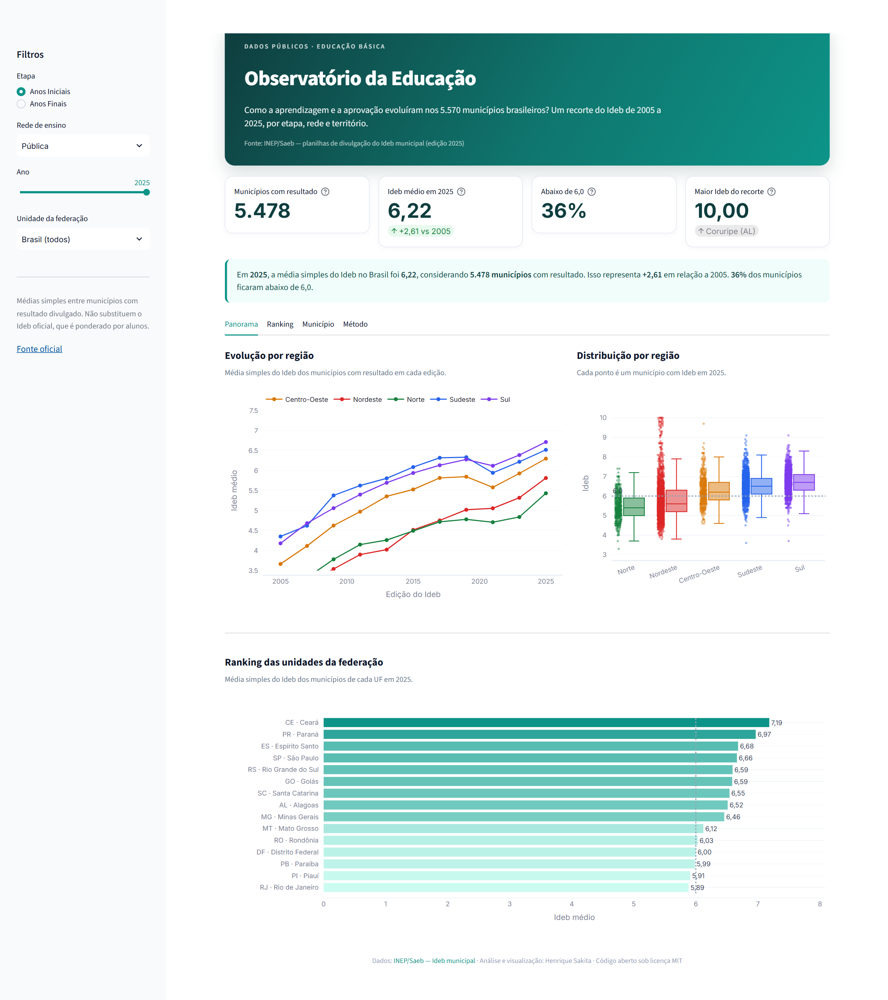
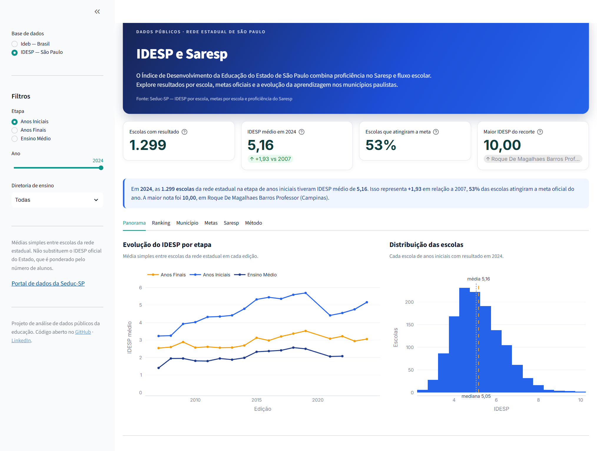

# Observatório da Educação

[](https://github.com/henriquesakita/observatorio-educacao/actions/workflows/ci.yml)
[](https://www.python.org/)
[](https://streamlit.io/)
[](LICENSE)

Dashboard em Python que transforma planilhas públicas da educação em uma leitura navegável da aprendizagem. O projeto baixa os arquivos oficiais do **Inep** e da **Seduc-SP**, trata os dados com pandas e apresenta séries históricas, rankings e comparações por município, escola, etapa, rede e território.

Duas bases convivem no mesmo painel:

- **Ideb — Brasil:** 5.571 municípios, 11 edições (2005–2025) e 339 mil registros. Anos Iniciais e Anos Finais cobrem 2005–2025; o Ensino Médio tem recorte municipal a partir de 2017.
- **IDESP e Saresp — São Paulo:** 5.424 escolas estaduais em 644 municípios (2007–2024), metas oficiais por escola (2019–2025) e proficiência municipal do Saresp (2011–2025).

---

## O problema

Os resultados educacionais são públicos, mas chegam em formatos pouco amigáveis: planilhas largas do Inep com cabeçalhos compostos e, no caso de São Paulo, dezenas de arquivos anuais da Seduc-SP com codificações e nomenclaturas diferentes. Comparar municípios, acompanhar a evolução de uma rede ou entender a diferença entre anos exige um trabalho de limpeza que afasta quem mais precisa desses números: gestores, professores, jornalistas e pesquisadores.

Este projeto faz esse trabalho uma vez, de forma reprodutível, e entrega a análise pronta para consulta.

## O que o painel responde

**Ideb (Brasil)**

- Como o Ideb evoluiu em cada região entre 2005 e 2025?
- Quais municípios têm os melhores e os menores resultados em cada edição?
- Quanto um município avançou desde a primeira edição disponível e como ele se compara à média da UF, da região e do Brasil?
- A melhora veio da **aprendizagem** (nota do Saeb) ou do **rendimento** (aprovação)?
- Quais unidades da federação lideram e quais ficaram para trás?

**IDESP e Saresp (rede estadual de São Paulo)**

- Como o IDESP evoluiu por etapa e por diretoria de ensino?
- Quais escolas e municípios têm os melhores resultados — e quais mais avançaram desde 2007?
- Quantas escolas atingiram a **meta oficial** do ano, e quais estão mais distantes dela?
- Como a proficiência do Saresp evoluiu em Língua Portuguesa e Matemática?
- O IDESP e o Ideb contam a mesma história sobre a rede estadual paulista?

## Principais achados — Ideb 2025, rede pública

| Indicador | Anos Iniciais | Anos Finais | Ensino Médio |
| --- | ---: | ---: | ---: |
| Municípios com resultado | 5.478 | 5.491 | 5.428 |
| Ideb médio (média simples) | **6,22** | **5,12** | **4,47** |
| Variação vs edição inicial | **+2,61** (2005) | **+1,81** (2005) | **+0,90** (2017) |
| Municípios abaixo de 6,0 | 36% | 89% | 99% |
| Avançaram desde a edição inicial | 99,9% | 99,8% | 93,8% |

- **Ceará** lidera os Anos Iniciais (7,19) e os Anos Finais (5,90). No Ensino Médio, o **Paraná** aparece na frente (5,04), seguido de Espírito Santo (5,03) e Rio Grande do Sul (4,89).
- **Amapá** (4,87) e **Roraima** (3,94) têm os menores resultados médios nos Anos Iniciais e Finais. No Ensino Médio, **Roraima** (3,34) e **Amazonas** (3,43) ficam no fim da lista.
- Entre 2005 e 2025, **Ibateguara (AL)** foi o maior avanço nos Anos Iniciais (+7,8) e **Branquinha (AL)** nos Anos Finais (+6,5). No Ensino Médio, **Presidente Kennedy (ES)** lidera (+3,7 desde 2017).
- Os Anos Finais concentram o maior desafio: nove em cada dez municípios ainda ficam abaixo de 6,0. No Ensino Médio esse quadro é ainda mais crítico — **99% dos municípios** ficaram abaixo da referência em 2025.

> As médias do painel são **simples entre municípios**. O Ideb oficial do Brasil e das UFs é ponderado pelo número de alunos, então os valores servem para comparar municípios — não substituem o indicador oficial. Essa escolha está explicada na aba **Método**.

## Principais achados — IDESP e Saresp, rede estadual de São Paulo

O **IDESP** combina a proficiência dos alunos no **Saresp** com o fluxo escolar e é publicado por escola. A base reúne resultados de **5.424 escolas em 644 municípios**, entre 2007 e 2024.

| Indicador | Anos Iniciais | Anos Finais | Ensino Médio |
| --- | ---: | ---: | ---: |
| Escolas com resultado em 2024 | 1.299 | 3.665 | — |
| IDESP médio em 2024 (média simples) | **5,16** | **3,06** | — |
| IDESP médio em 2022 (última edição do EM) | 4,55 | 3,22 | **2,08** |
| Variação vs primeira edição | **+1,93** (2007) | **+0,52** (2007) | **+0,67** (2007–2022) |
| Escolas que atingiram a meta em 2024 | **52,9%** | **26,4%** | — |

- Nos Anos Iniciais, **Teodoro Sampaio** tem o maior IDESP de 2024 (8,94) e **Cotia** o menor (3,08). Teodoro Sampaio também registra o maior avanço municipal desde 2007 (**+6,09**). Nos Anos Finais, **Vista Alegre do Alto** lidera (7,19), **Santo Expedito** fica no fim (1,61) e **Nova Castilho** é o maior ganho (**+4,17**).
- Entre as diretorias de ensino, **Mirante do Paranapanema** tem o maior IDESP nos Anos Iniciais em 2024 (7,59) e **Santos** o menor (3,98).
- O cumprimento das metas é muito desigual: em 2024, **52,9%** das escolas de Anos Iniciais atingiram a meta, mas apenas **26,4%** nos Anos Finais. Por diretoria, Franca chega a **88,2%** nos Anos Iniciais contra **22,2%** de Taboão da Serra; nos Anos Finais, Fernandópolis atinge **66,7%** e Jaboticabal apenas **8,7%**.
- Em **2021**, no retorno do Saresp após a suspensão de 2020, somente **1,1%** das escolas de Anos Iniciais atingiram a meta — o IDESP médio caiu de 5,69 (2019) para 4,41. A recuperação foi parcial: em 2024 o valor chegou a 5,16, ainda abaixo de 2019.
- O **Saresp de 2025** (9º ano, rede estadual) registrou média de **248,5** em Língua Portuguesa e **270,9** em Matemática. As duas proficiências são fortemente correlacionadas entre municípios (**r = 0,905**, n = 506).
- **IDESP e Ideb concordam** sobre o ranking municipal da rede estadual: em 2023, a correlação foi de **r = 0,829** nos Anos Finais (n = 492) e **r = 0,762** nos Anos Iniciais (n = 100).

> O IDESP oficial do Estado é **ponderado pelo número de alunos**; as médias do painel são simples entre escolas. A comparação com o Ideb é exploratória: os dois indicadores usam escalas e metodologias diferentes.

## Demo

**[Abrir o painel publicado](https://observatorio-educacao.streamlit.app/)**

[](https://observatorio-educacao.streamlit.app/)

O painel roda no Streamlit Community Cloud direto do branch `main`: qualquer push
atualiza a versão publicada. A base é escolhida na barra lateral.

**Ideb — Brasil**



**IDESP e Saresp — São Paulo**



## Como rodar

```bash
git clone https://github.com/henriquesakita/observatorio-educacao.git
cd observatorio-educacao

python -m venv .venv
source .venv/bin/activate        # Windows: .venv\Scripts\activate
pip install -r requirements-dev.txt

streamlit run app.py
```

O painel abre em `http://localhost:8501`.

### Regerar os dados

Os recortes tratados já estão versionados em `data/processed/`. Para baixar as planilhas originais e refazer cada pipeline:

```bash
python scripts/build_dataset.py   # Ideb municipal (Inep)
python scripts/build_idesp.py     # IDESP, metas e Saresp (Seduc-SP)
```

O primeiro script baixa os arquivos das três etapas direto do Inep, extrai os `.xlsx`, limpa o cabeçalho composto e grava o CSV comprimido. O segundo baixa os CSVs do portal de dados abertos da Seduc-SP, lida com codificações diferentes (UTF-8, UTF-8 com BOM e Latin-1), mapeia os municípios pela base do IBGE e empilha as edições. Os arquivos brutos ficam em `data/raw/` e não são versionados.

### Testes e qualidade

```bash
pytest          # 37 testes
ruff check .    # lint
```

A CI roda lint e testes a cada push e pull request, além de validar a importação do dashboard em um ambiente limpo.

## Estrutura

```
observatorio-educacao/
├── app.py                      # entrada do Streamlit
├── src/observatorio/
│   ├── config.py               # UFs, regiões, anos e caminhos
│   ├── ingest.py               # download dos ZIPs do Inep
│   ├── transform.py            # limpeza e formato tidy do Ideb
│   ├── metrics.py              # agregações e rankings do Ideb
│   ├── idesp.py                # IDESP, metas e Saresp: limpeza e métricas
│   ├── ui.py                   # CSS e componentes visuais compartilhados
│   ├── ideb_app.py             # base Ideb — Brasil
│   ├── idesp_app.py            # base IDESP — São Paulo
│   └── app.py                  # seletor de base e entrada do painel
├── scripts/
│   ├── build_dataset.py        # pipeline do Ideb
│   ├── build_idesp.py          # pipeline do IDESP/Saresp
│   └── build_municipios.py     # municípios de SP (IBGE)
├── tests/                      # transformação, métricas e dados processados
├── data/processed/             # recortes tratados (~10 MB)
├── data/reference/             # municípios de SP
└── .github/workflows/ci.yml
```

## Pipeline

```
INEP (ZIP/XLSX)      → ingest.py  → transform.py → CSV tidy → metrics.py → Streamlit + Plotly
Seduc-SP (CSV)       → idesp.py   → CSV tidy     → idesp.py  → Streamlit + Plotly
```

O formato final do Ideb é **longo**: uma linha por `ano × etapa × município × rede`, com Ideb, nota de Matemática, nota de Português, nota média, indicador de rendimento, taxa de aprovação e meta (quando existe). O mesmo desenho vale para o IDESP: uma linha por `ano × etapa × escola`, além de bases separadas para metas e para o Saresp municipal. Esse desenho simplifica filtros, séries temporais e testes.

### Decisões técnicas

- **pandas + openpyxl** para ler um cabeçalho de três níveis e descartar as linhas de notas do Inep.
- **Leitor flexível de CSV** (`read_csv_flexible`) para lidar com UTF-8, UTF-8 com BOM, Latin-1 e separadores diferentes nos arquivos da Seduc-SP.
- **CSV comprimido versionado** para que o dashboard funcione sem depender de rede ou de pastas `data/raw/` grandes.
- **Médias explícitas**: toda agregação é simples e rotulada como tal, evitando confundir o painel com os indicadores oficiais.
- **Separação entre dados e interface**: `metrics.py` e `idesp.py` são testáveis sem Streamlit; a UI só orquestra.
- **Duas bases, um app**: `app.py` escolhe entre `ideb_app.py` e `idesp_app.py`, que compartilham CSS e componentes em `ui.py`.
- **Cache do Streamlit** no carregamento dos CSVs e nenhuma chamada externa em tempo de execução.
- **Testes de consistência**: o Ideb divulgado é comparado com `N × P` (tolerância de arredondamento), as chaves são verificadas contra duplicidade e a cobertura das bases é validada.

## Limitações

**Ideb**

- O Ideb combina aprovação e desempenho no Saeb; **não mede equidade, infraestrutura ou aprendizagem por aluno**.
- O Inep não divulga resultados com participantes insuficientes no Saeb ou sob solicitação de não divulgação. Por isso o número de municípios varia entre edições.
- O Ideb do **ensino médio** só tem recorte municipal a partir de **2017**; as edições anteriores trazem apenas o resultado nacional. A cobertura municipal também cai bastante em **2021** (pandemia).
- A edição de **2021** reflete a pandemia de Covid-19 e deve ser lida com cautela.
- O primeiro ciclo de metas terminou em 2021; as edições seguintes **não têm metas oficiais**.
- As planilhas municipais trazem as redes pública, estadual, municipal e federal; a rede privada não entra no recorte municipal.
- A referência de **6,0** é uma linha de leitura, não uma meta oficial do Inep.

**IDESP e Saresp**

- O painel cobre apenas a **rede estadual paulista**. Escolas municipais, privadas e federais não entram no IDESP.
- As médias são **simples entre escolas**: cada escola pesa igual. O IDESP oficial do Estado é ponderado pelo número de alunos, então os valores **não substituem** o indicador oficial.
- O IDESP do **ensino médio** é publicado até **2022**; as edições de 2023 e 2024 trazem apenas anos iniciais e finais.
- As **metas oficiais por escola** começam em **2019** (não há meta em 2020). A comparação usa tolerância de 0,05 ponto.
- O **Saresp de 2014** foi publicado com apenas 183 municípios e é **omitido** dos gráficos e séries.
- Em **2020 não houve Saresp** por causa da pandemia; **2021** deve ser lido com cautela.
- A proficiência do Saresp **não é uma nota de 0 a 10**: é a escala do próprio exame.
- A partir de 2022 o portal também publica a rede **municipal**; o painel exige a escolha explícita da rede.
- O IDESP e o Ideb usam metodologias e escalas diferentes. A comparação entre eles é apenas **exploratória** e só é feita quando as edições estão a até dois anos de distância.

## Próximos passos

- Ponderar as médias pelo número de alunos (Censo Escolar) para reproduzir os agregados oficiais do Ideb e do IDESP.
- Adicionar um mapa coroplético dos municípios paulistas e brasileiros.
- Cruzar os indicadores com dados socioeconômicos, de infraestrutura e de fluxo escolar.
- Publicar um modelo de alerta de evasão com interpretabilidade (SHAP) como próximo projeto da trilha de dados.

## Fonte

**Ideb (Brasil)**

- [INEP — Resultados do Ideb](https://www.gov.br/inep/pt-br/areas-de-atuacao/pesquisas-estatisticas-e-indicadores/ideb/resultados)
- Planilhas: `divulgacao_anos_iniciais_municipios_2025.zip`, `divulgacao_anos_finais_municipios_2025.zip` e `divulgacao_ensino_medio_municipios_2025.zip`
- Edição de referência: **Ideb 2025** (Saeb 2025 + Censo Escolar 2025)

**IDESP e Saresp (São Paulo)**

- [Seduc-SP — Portal de dados abertos](https://dados.educacao.sp.gov.br/search/type/dataset): resultados do IDESP por escola, metas por escola e proficiência do Saresp por município
- [Saresp — consulta pública](https://saresp.fde.sp.gov.br/ConsultaRede.aspx?opc=1&tipo=Rede%20Estadual)
- [IBGE — municípios de São Paulo](https://servicodados.ibge.gov.br/api/v1/localidades/estados/SP/municipios) para o mapeamento de códigos e nomes
- Edições: IDESP **2007–2024** (sem 2020), metas **2019–2025** (sem 2020) e Saresp **2011–2025** (sem 2020)

## Sobre

Projeto de portfólio de **Henrique Sakita**, professor de Ciências e Biologia em transição para dados. Une 12 anos de sala de aula à prática de Python, SQL e estatística para transformar dados públicos em decisões educacionais.

- GitHub: [@henriquesakita](https://github.com/henriquesakita)
- LinkedIn: [henrique-sakita](https://www.linkedin.com/in/henrique-sakita/)
- Contato: [henriquesakita@gmail.com](mailto:henriquesakita@gmail.com)

## Licença

MIT — veja [LICENSE](LICENSE).
